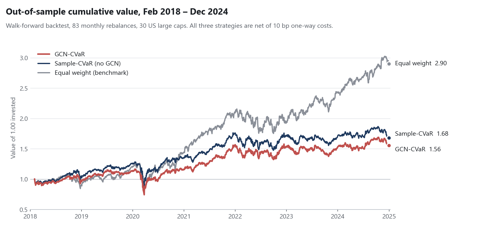
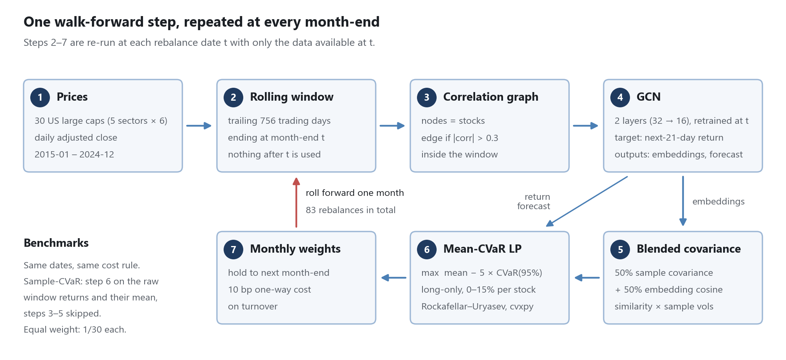
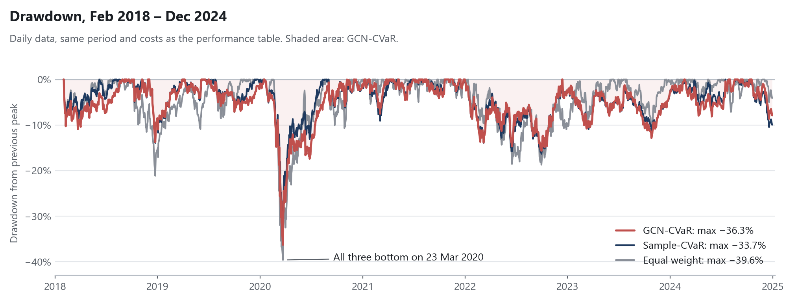
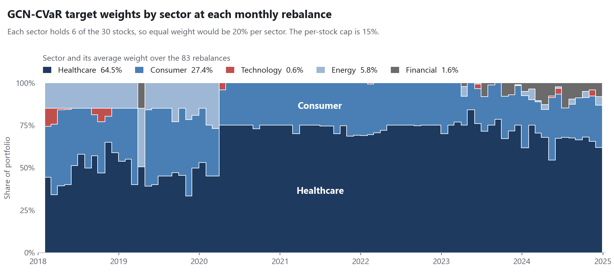

# GCN + CVaR Portfolio Optimisation (walk-forward)

> A graph convolutional network shapes the covariance matrix of a long-only mean-CVaR portfolio of 30 US large caps, re-solved monthly in a walk-forward backtest and reported out of sample, net of costs.

김재하 (Jaeha Kim) · [github.com/summerjinhere](https://github.com/summerjinhere)



## 개요

미국 대형주 30종목의 동조 구조를 GCN(graph convolutional network)으로 학습하고, 그 노드 임베딩을 공분산 추정에 반영한 뒤 long-only mean-CVaR 최적화로 비중을 정하는 포트폴리오를 만들었다. 매월 말 그 시점까지의 데이터만으로 모형을 다시 학습하고 비중을 다시 푸는 walk-forward 방식으로 검증했다.

표본 외 구간(2018-02 – 2024-12)의 결과는 다음과 같다.

- GCN-CVaR는 동일가중 대비 일간 CVaR(95%)을 3.3%에서 2.6%로, 연 변동성을 21.7%에서 17.5%로 낮췄다.
- 수익률과 Sharpe는 동일가중에 크게 못 미쳤다(연 6.6% 대 16.7%, Sharpe 0.46 대 0.82).
- GCN을 뺀 같은 최적화(Sample-CVaR)와 비교해도 GCN을 넣은 쪽이 낫지 않았다(Sharpe 0.46 대 0.52).

이 설정에서는 GCN 공분산의 이점을 확인하지 못했고, 이 저장소는 그 결과를 그대로 기록한다.

## 설계



| 항목 | 설정 |
|---|---|
| Universe | 5개 섹터 × 6종목 = 30종목 (Technology, Healthcare, Financial, Consumer, Energy. 섹터별 종목 리스트의 앞 6개를 사전에 고정) |
| Data | 일별 수정종가, 2015-01 – 2024-12 (Yahoo Finance, `yfinance`) |
| Walk-forward | 월 1회 리밸런싱, 직전 3년(756거래일) 학습 윈도우, 리밸런싱일 이후 정보는 쓰지 않음 |
| Graph | 학습 윈도우 안에서 \|상관계수\| > 0.3이면 edge |
| GCN | 2층(32 → 16). 윈도우 안의 월별 스냅샷으로 각 종목의 향후 21거래일 수익률을 예측하도록 학습 |
| Covariance | 표본 공분산 50% + GCN 임베딩의 cosine similarity × 표본 변동성으로 만든 target 50% |
| Optimiser | 평균 − 5 × CVaR(95%) 최대화. Rockafellar–Uryasev LP, `cvxpy`(Clarabel), 종목별 비중 0–15% |
| Costs | 회전율에 편도 10bp |

코드에서 확인할 수 있는 세부 사항은 다음과 같다.

- 노드 특징은 종목별 6개다. 21·63·252일 누적수익률, 21·63일 변동성, 63일 수익률의 5% 분위수.
- CVaR 시나리오는 학습 윈도우의 일별 수익률 756개다. GCN-CVaR는 이 시나리오를 GCN 혼합 공분산에 맞게 변환해서 쓰고, 기대수익률로는 GCN의 21일 예측치를 일 단위로 나눈 값을 쓴다.
- Sample-CVaR는 같은 LP에 윈도우 수익률과 그 표본평균을 그대로 넣는다. 따라서 두 전략은 공분산뿐 아니라 기대수익률 입력도 다르다.
- 비용은 리밸런싱 직전 비중(보유 중 가격 변동 반영)과 새 목표 비중의 차이 절댓값 합에 10bp를 곱해 보유 첫날 수익률에서 뺀다. 세 전략에 같은 규칙을 적용했고, 동일가중도 매월 1/30로 되돌리면서 비용을 낸다.

하이퍼파라미터는 실행 전에 정했고 테스트 구간에서 튜닝하지 않았다. 전체 값은 `results/config.json`에 있다.

## 표본 외 결과 (2018-02 – 2024-12, 리밸런싱 83회)

| 전략 | 연 수익률 | 연 변동성 | Sharpe | Sortino | Max DD | 일간 CVaR 95% | 누적수익률 |
|---|---|---|---|---|---|---|---|
| GCN-CVaR | 6.6% | 17.5% | **0.46** | 0.56 | −36.3% | 2.6% | +55.8% |
| Sample-CVaR (같은 최적화, GCN 없음) | 7.8% | 17.5% | 0.52 | 0.64 | −33.7% | 2.6% | +68.3% |
| Equal weight | 16.7% | 21.7% | 0.82 | 1.00 | −39.6% | 3.3% | +190.3% |

세 전략 모두 같은 기간(1,739거래일), 같은 리밸런싱 날짜, 같은 비용 규칙으로 계산했다. Sharpe는 무위험수익률 0을 기준으로 한다. 누적수익률을 제외한 값은 `results/performance.csv`에서 가져왔고, 누적수익률과 아래 연도별 수익률은 `results/daily_returns.csv`에서 다시 계산했다.



세 전략 모두 2020-03-23에 최대 낙폭을 기록했다. GCN-CVaR의 낙폭(−36.3%)은 동일가중(−39.6%)보다 작지만 Sample-CVaR(−33.7%)보다 크다.

| 연도 | GCN-CVaR | Sample-CVaR | Equal weight |
|---|---|---|---|
| 2018 (2월부터) | −1.5% | +5.5% | −9.4% |
| 2019 | +15.1% | +19.1% | +32.7% |
| 2020 | +3.0% | +8.4% | +20.4% |
| 2021 | +34.4% | +29.5% | +44.6% |
| 2022 | −2.4% | −2.7% | −6.8% |
| 2023 | −0.8% | −1.4% | +24.5% |
| 2024 | +2.5% | −0.5% | +19.5% |

## 결과 해석과 한계



**해석.** 목적함수에서 CVaR 항이 지배적이어서 포트폴리오가 최소 꼬리위험 포트폴리오처럼 움직인다.

- 83회 리밸런싱의 평균 비중은 Healthcare 64.5%, Consumer 27.4%, Energy 5.8%, Financial 1.6%, Technology 0.6%다. 비중 1% 이상인 종목은 평균 8개 정도이고, 그중 5–6개가 상한 15%에 걸려 있다(`results/gcn_cvar_weights.csv` 기준).
- 그 결과 일간 CVaR와 변동성이 낮아졌고 최대 낙폭도 동일가중보다 조금 작다. 동일가중이 하락한 2018년과 2022년에는 덜 떨어졌다.
- 반면 2018–2024년에 Technology를 거의 담지 않아 이 기간 상승분의 대부분을 놓쳤다. 연도별 표에서 2023년과 2024년의 격차가 특히 크다.
- GCN 공분산은 표본 공분산 대비 성과를 개선하지 못했다. 두 전략의 일간 수익률 상관계수는 0.98로, 거의 같은 포트폴리오다.

**한계.**

- GCN-CVaR와 Sample-CVaR의 차이가 통계적으로 유의한지는 검정하지 않았다. 표본 외 구간도 약 7년짜리 하나뿐이다.
- 두 전략은 기대수익률 입력도 다르므로, 성과 차이를 공분산 추정 방식만의 효과로 분리해서 말할 수 없다.
- 시드(42)와 하이퍼파라미터 조합은 하나만 돌렸다. 상관 임계값, 혼합 비율, 위험회피 계수에 대한 민감도는 확인하지 않았다.
- 유니버스는 현재 시점에서 고른 대형주 30개로 고정했다. 과거 시점의 지수 구성을 복원한 것이 아니어서 생존 편향이 있을 수 있고, 이는 세 전략의 절대 수익률 모두에 영향을 준다.
- 벤치마크는 같은 30종목의 동일가중뿐이며 S&P 500 같은 시장지수와는 비교하지 않았다.
- 리밸런싱일 종가로 신호 계산과 체결이 함께 이뤄진다고 가정했다. 비용은 편도 10bp 고정이고 시장충격과 세금은 반영하지 않았다.

## 저장소 구조

현재 버전: 위 결과를 만든 코드와 산출물이다.

| 경로 | 내용 |
|---|---|
| `gnn_cvar_walkforward.py` | walk-forward 백테스트 전체. 데이터 수집, GCN 학습, 공분산, CVaR LP, 성과 계산 |
| `results/daily_returns.csv` | 세 전략의 표본 외 일별 수익률 (비용 차감 후) |
| `results/gcn_cvar_weights.csv` | GCN-CVaR의 리밸런싱일별 목표 비중 (83행 × 30종목) |
| `results/performance.csv` | 성과 지표 표 |
| `results/config.json` | 실행에 쓴 설정값 |
| `assets/` | 이 README의 그림. `results/`의 파일만으로 그렸다 |

이전 버전: 2025년 3–6월의 탐색 단계다. 참고용으로 남겼으며 위 결과와는 무관하다.

| 경로 | 내용 |
|---|---|
| `gnn_cvar_portfolio_v3.py` | 첫 GCN 프로토타입. 단일 80/20 분할, `scipy` 최적화 |
| `portfolio_final.py`, `portfolio_final.ipynb` | Colab 노트북과 그 내보내기. 섹터 상관 분석과 전통적 포트폴리오 baseline(Sharpe 최대화, 최소분산, efficient frontier, 모멘텀 리밸런싱). `.py`에는 노트북 셀 명령이 섞여 있어 그대로는 실행되지 않는다 |
| `stock_network_analysis_v1.py`, `_v2.py` | 한국 주식의 상관·Granger 네트워크와 중심성 분석 |
| `figures/` | 위 스크립트와 노트북 단계의 그림. walk-forward 결과와 대응하지 않는다 |
| `models/best_gnn_model.pth` | 이전 실험의 모형 가중치. 학습 코드는 이 저장소에 없다 |

## 실행 방법

```bash
pip install numpy pandas torch cvxpy yfinance
python gnn_cvar_walkforward.py      # CPU에서 약 5분
```

실행하면 `results/`의 네 파일을 다시 쓴다. 시드는 고정되어 있지만 Yahoo Finance의 수정종가는 조회 시점에 따라 달라질 수 있어, 재실행 결과가 커밋된 수치와 조금 다를 수 있다.

## 데이터

가격은 첫 실행 때 `yfinance`로 내려받아 `data/prices.csv`에 캐시한다. Yahoo Finance 약관상 재배포가 허용되지 않으므로 원시 가격 데이터는 저장소에 포함하지 않았고, `data/`의 가격 파일은 `.gitignore`로 제외했다.
